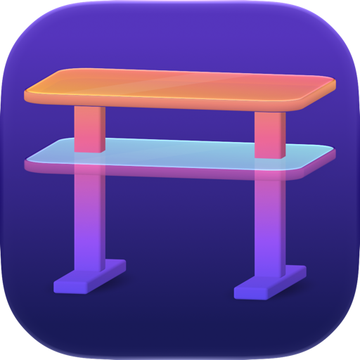
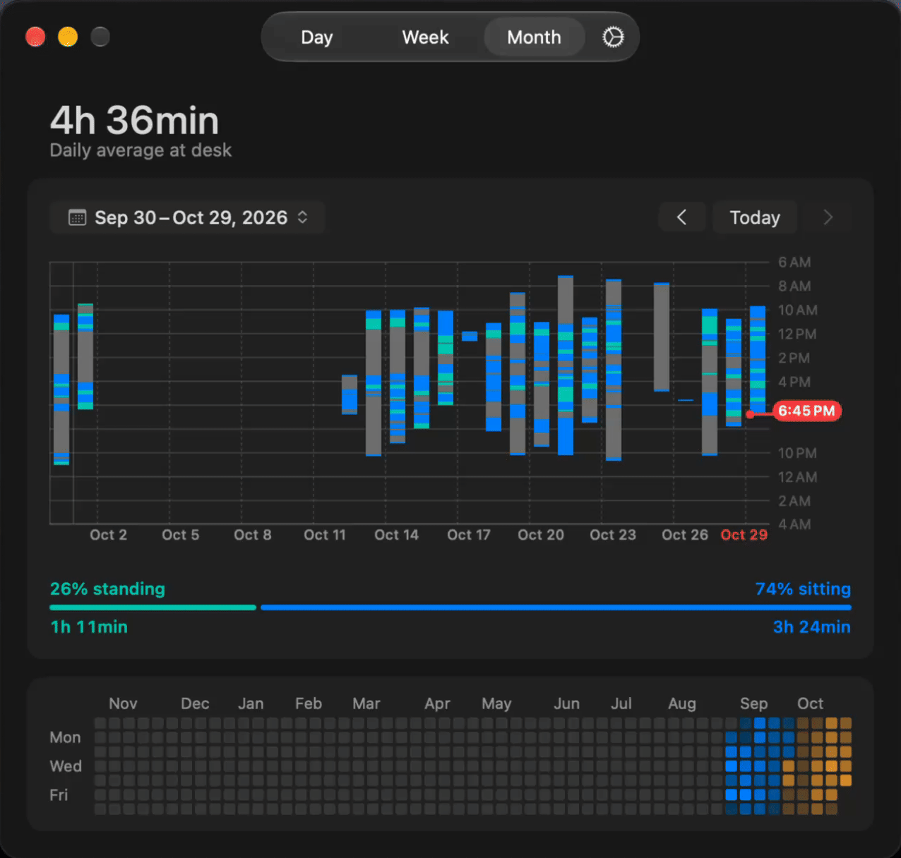
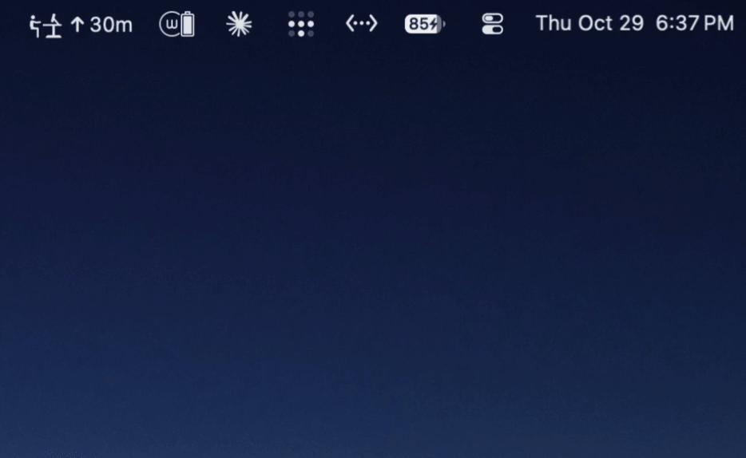
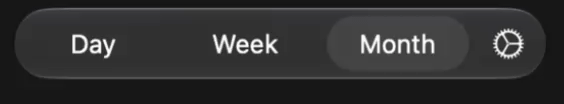

<p align="center">
  
</p>

<h1 align="center">Deskpilot</h1>
<p align="center">Your standing desk, at a glance.</p>
<p align="center">Native macOS · Rust engine · Bluetooth · GPLv3 licensed</p>

Deskpilot brings your **Ergodriven Tempo** standing desk to the Mac menu bar, with a
live height indicator, countdown to your next sit or stand, and a dashboard of your day.
Scroll through your activity, see how your habits change over time, and adjust your
sit–stand routine without opening the phone app.

<p align="center">
  
</p>
<p align="center"><em>Scroll through your desk history.</em></p>

### Made for the menu bar

The desk icon follows your desk's height. Watch an automatic move approach, see the
height change while it travels, and check your time at the desk and number of stands.
The menu also shows today's timeline and a switch to pause or resume cruise control.

<p align="center">
  
</p>
<p align="center"><em>The menu bar icon and popover, recorded on my Mac.</em></p>

<p align="center"><strong>Live height during a move</strong></p>
<p align="center">
  
</p>

### Explore your day

Scroll the timeline to inspect a different part of the day. The standing/sitting split
and totals follow the visible range. Switch between Day, Week and Month, or choose a day
from the year heatmap. Light, dark and system appearances are supported.

<p align="center">
  
</p>
<p align="center"><em>Day, Week, Month and Settings.</em></p>
<p align="center"><em>All app demonstrations were manually recorded from the running app.</em></p>

### What works today

- Live height, movement, presence, posture and automatic-move countdown.
- Daily activity, Day/Week/Month charts, a year heatmap and preserved history.
- Cruise timing, pause/resume, preset capture and user settings.
- A desktop widget and App Intents, sharing the menu app's snapshot and command queue.
- Local storage and daily history backups. Deskpilot communicates directly over BLE;
  its normal operation needs no vendor cloud account.

**A Tempo controller is required.** Deskpilot does not connect directly to an arbitrary
FlexiSpot or other standing desk. No direct “raise now” or “go to height” command has
been verified through Tempo's BLE interface. “Use current height” saves a preset after
you move the desk using its paddle.

The countdown is an estimate before the desk announces a move. Presence has the
controller's own debounce, and cancelled moves are inferred from its observed behavior.
See the [protocol notes](docs/protocol.md) for the evidence and limitations.

### Build on macOS

Requires macOS 14+, a recent Xcode with Icon Composer support, XcodeGen, and Rust 1.89+.
The current source was built with Xcode 27 and tested on Apple Silicon. Older macOS
versions and Intel Macs need broader testing. There is no notarized installer yet.

```sh
git clone https://github.com/slaughterhousesoftware/deskpilot.git
cd deskpilot
brew install xcodegen rust
make kit-test
make rust-test
make app
make dashboard
open App/DerivedData/Build/Products/Release/Deskpilot.app
open "App/DerivedData/Build/Products/Release/Deskpilot Dashboard.app"
```

These targets produce unsigned development builds. For a signed installation and the
widget, set your own development team in `App/project.yml`, configure an App Group for
that team, and replace the existing group identifier consistently in the entitlements,
Swift snapshot store and Rust CLI data-directory default. The existing bundle and group
IDs are retained for compatibility with earlier installations. Build both schemes with
signing enabled, put both apps in `/Applications`, and launch Deskpilot before adding its
widget. Allow Bluetooth access when macOS asks.

Pair the Mac with Tempo once: hold the controller's UP paddle for four seconds and enter
the six-digit code when macOS requests it. Quit other software holding Tempo's Bluetooth
connection before starting Deskpilot.

To try the UI without hardware:

```sh
DESKPILOT_SIMULATE=busyDay App/DerivedData/Build/Products/Release/Deskpilot.app/Contents/MacOS/Deskpilot
```

The simulator uses separate temporary data. For developer screenshots and simulated recordings, install
FFmpeg and run `python3 scripts/capture-demos.py` after building both apps. Capture on a
Retina display for native 2× pixels; the encoder preserves the source resolution.
Desktop-context captures require Screen Recording permission for the capturing app.
`--history-directory DIR` optionally reads a local copy of real history, snapshot and
service-frame files; it exports rendered media only.

### Under the hood

One Rust process owns Bluetooth, protocol decoding, history, timing and persistence.
The SwiftUI/AppKit menu app hosts it and receives versioned JSON state frames. The
Dashboard and WidgetKit extension read shared files; commands return through one queue.
An OS file lock prevents two services from owning the same data directory. Closing the
host's input shuts down its child, and the app restarts a crashed backend.

The Rust workspace separates the synchronous protocol/state machine (`tempo-core`),
async service (`tempo-desk`), BLE transport (`tempo-ble`), and CLI (`tempo-cli`). The CLI
also runs independently. See [Rust usage and testing](rust/README.md).

### Next

A Windows desktop app using the same Rust engine is the next platform direction.
The BLE transport supports multiple platforms through btleplug; Windows and Linux
hardware behavior still needs validation. Packaging, signed releases and broader
controller testing are also future work.

Deskpilot is a [Slaughterhouse Software](https://github.com/slaughterhousesoftware)
project, built by Kevin Patel with Claude and Codex. Its Tempo support comes from
protocol research and testing on real hardware. It is independent of Ergodriven and
FlexiSpot.

### License

Copyright © 2026 Kevin Patel. Deskpilot is licensed under the
[GNU General Public License, version 3 only](LICENSE) (`GPL-3.0-only`).

You can use, study, modify, and share Deskpilot. If you distribute a modified version,
you must provide its corresponding source under GPLv3 and preserve the required notices.
Commercial use and selling copies are allowed; GPLv3 protects software freedoms rather
than requiring a zero price. Dependencies retain their respective licenses.
